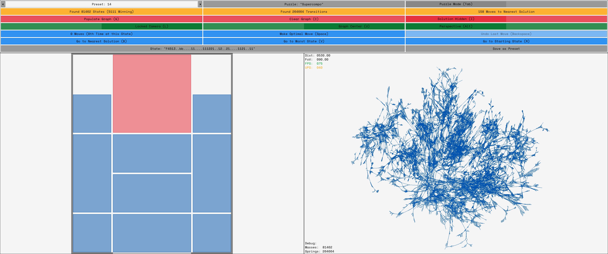

# MassSprings - Puzzle Board State Space Explorer

All combinations of pieces reachable from an initial puzzle are explored, the resulting puzzle state-space is visualized as a force-directed graph.
The graph layout is calculated iteratively using a mass-spring-system with additional pairwise repulsive forces simulated using Barnes-Hut.



## Running

Requirements for a locally built binary:

- Directory `fonts`
- Directory `shader`
- Preset file `default.puzzle` (optional)

Run the application with:

```sh
nix run git+https://gitea.local.chriphost.de/christoph/cpp-masssprings
```

The Nix wrapper bundles `fonts/`, `shader/` and `default.puzzle`, so it can be started from any directory. A locally built binary has to be started from a directory containing the listed requirements. Program arguments go after `--`:

```sh
nix run git+https://gitea.local.chriphost.de/christoph/cpp-masssprings -- --help
```

### Command line arguments

| Argument | Default | Description |
| --- | --- | --- |
| `<preset-file>` / `--presets <file>` | `default.puzzle` | Preset file loaded by the GUI |
| `--output <file>` | `clusters.puzzle` | Output file for generated clusters |
| `--space <rh\|klotski>` | – | Generate a puzzle space headlessly instead of opening the GUI |
| `--blocks <1..15>` | `5` | Maximum number of blocks per generated puzzle |
| `--moves <int>` | `10` | Minimum required moves for a cluster to be saved (longest shortest solution in the cluster) |
| `--help` | – | Print the available options and exit |

`--output`, `--blocks` and `--moves` only take effect together with `--space`. The available rulesets are `rh` (Rush Hour, 6×6) and `klotski` (Klotski, 4×5); any other value falls back to the GUI. Command line parsing is compiled out on Windows, where the program always starts the GUI.

Examples:

```sh
# GUI with a custom preset file
nix run git+https://gitea.local.chriphost.de/christoph/cpp-masssprings -- presets/my.puzzle

# Headless Rush Hour space generation
nix run git+https://gitea.local.chriphost.de/christoph/cpp-masssprings -- --space rh --output clusters.puzzle --blocks 4 --moves 10
```

### Settings

The **Settings** button in the top bar (or the **`,`** key) opens a live settings overlay: Barnes-Hut parameters, tree depth and rebuild interval, integration/physics constants, link and constraint parameters, camera speeds, rendering options (node size, edges, edge LOD stride, billboard nodes), task block sizes and the log level (0 = off, 1 = info, 2 = detailed). The Performance tab also shows a rolling 10-second graph with physics and render timings. Changes apply immediately where possible; the tree depth is picked up by the next rebuild, the async-octree switch is applied on the next physics step, and the worker-thread count is applied at startup. The GPU-repulsion switch is a placeholder for now.

Settings are persisted to `settings.ini` in the working directory on a clean exit and loaded at startup. **Reset All** restores the defaults.

## Technical

### Architecture

The application is split into four layers:

- `puzzle` (`puzzle.hpp`, `puzzle.cpp`) - immutable, bit-packed board states and all state-space operations.
- `state_manager` - stores unique states and their links, tracks the move history, winning states, shortest paths and visit counts, and keeps the physics engine in sync.
- `cpu_layout_engine`, `cpu_spring_system` and `octree` - the background physics thread that iteratively lays out the graph.
- `renderer`, `user_interface` and `input_handler` - the raylib front end with the 3D graph view, the 2D puzzle board and the menu.

Input flows from the user through `state_manager` into the layout engine. The renderer only reads the latest positions published by the physics thread.

### Puzzle representation

A puzzle occupies 32 bytes (4 × `u64`): a 16-bit metadata field (width, height, goal position, restricted-movement flag and goal-present flag) followed by 15 block slots. Each block is packed into a 16-bit integer holding its position, size minus one, and its target/wall flags.

The block array is kept sorted, so equal states have identical memory representations and are compared and hashed as raw integers. Every state also exposes 64-bit board bitmaps (occupancy, horizontal and vertical coverage), which are used to validate moves and placements without scanning the block list.

Boards may be 3×3 to 8×8 and hold at most 15 blocks.

### State-space generation

In `--space` mode a puzzle space is derived from a ruleset:

1. Generate every multiset of permitted block shapes that fits on the board, with the target block counting towards the `--blocks` limit.
2. Place each block set recursively on the board: the next empty cell found by the occupancy bitmap is either left empty or filled with one of the remaining blocks.
3. Place the target block at every allowed position and explore all reachable states with a breadth-first search over legal moves, deduplicating states by their packed representation.
4. Group the states into connected components (clusters). A cluster is identified by its numerically smallest state.
5. Compute each state's distance to the nearest solved state. A cluster is only kept if its largest distance (the longest shortest solution) is at least `--moves`; the remaining clusters are written to the output file.

### Preset file format

A preset is a single line, preceded by exactly one comment line:

```
# Klotski
S:[4x5] G:[1,3] M:[F] B:[{1x2 2X2 _ 1x2} {_ _ _ _} {1x2 2x1 _ 1x2} {_ 1x1 1x1 _} {1x1 _ _ 1x1}]
```

The fields are:

- `S:[WxH]` - board size (3 to 8 per axis)
- `G:[x,y]` - goal cell for the target block (optional)
- `M:[R|F]` - restricted movement (blocks only move along their longer axis, square blocks in any direction) or free movement
- `B:[{...} ...]` - the board rows

Inside the braces every cell contains either `_` or a block sized `W`×`H` that is anchored at its top-left corner. Movable blocks use `WxH`, the target block uses `WXH` and immovable walls use `W*H`. Cells covered by a block anchored earlier remain `_`. Each preset line has to be accompanied by one `#` comment line, which is shown as the preset's name.

### Graph layout and physics

Each puzzle state is a mass and each legal move is a link. Links have a **hard minimum length** (`REST_LENGTH`): after integration, compressed links are projected back to that length (position-based dynamics). Above the minimum, a tension-only spring (`SPRING_K`) with velocity damping pulls linked masses together. In addition, all pairs of masses repel each other.

The minimum-length projection is what keeps dense clusters stable: there is no stiff spring/repulsion force balance at short range, which used to cause persistent jitter. Springs are projected in parallel using an edge coloring in which no two links of the same color share a mass.

Repulsion is calculated with Barnes-Hut using a linear octree built from Morton codes of the mass positions; distant nodes are approximated by their center of mass once the node's size-to-distance ratio exceeds `THETA`. Force queries use the exact position snapshot the tree was built from, so a lagged tree does not produce a mismatched force field. The simulation runs in 3D at 90 updates per second using Verlet integration with slight damping. All tunable constants live in `include/config.hpp`.

New masses are spawned close to their neighbor, so the graph initially "explodes" and then settles into clusters. `OCTREE_REBUILD_INTERVAL` and `CONSTRAINT_INTERVAL` control how often the tree and the link projection are refreshed; both default to every step for stability.

### Threading model

The layout engine runs on its own thread. The main thread submits commands (add mass, add spring, clear graph) through a mutex-protected queue, and the physics thread hands its positions back through a mutex-protected exchange with ready/consumed condition variables.

When **Async octree build** is enabled in the settings (the default), the octree for the next frame is built on a dedicated thread while forces are computed from the previous tree; it can be switched at runtime. The optional `BS::thread_pool` (enabled by `THREADPOOL`) parallelizes spring forces, repulsion forces, the link projection and integration. Its worker count can be set in the settings (0 = automatic) and is applied at startup.
